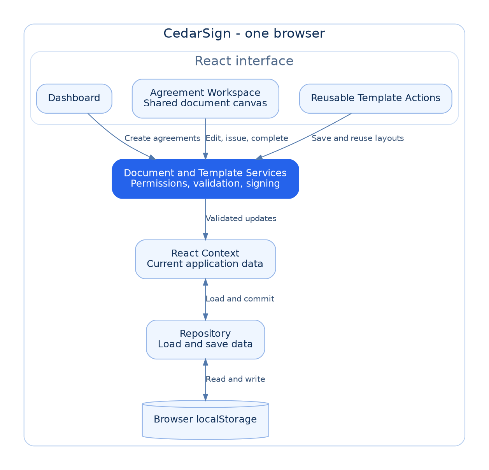

# CedarSign

## 1. How to run it

Use Node 22.12+ in the 22 release line or Node 24+, with npm:

```sh
git clone https://github.com/Lotstarr/CedarSign.git
cd CedarSign
npm ci
npm run dev
```

Open the URL printed by Vite. No database, credentials, or environment variables are needed. As Jordan, open the draft demo, choose Casey, enter a signature and title, and issue. Switch to Casey to complete and sign; Morgan demonstrates unrelated-user restrictions. README.md contains the full walkthrough and browser-test commands.

`npm test` runs service tests. `npm run build` checks TypeScript and creates production assets.

There is also a Vercel deployment at [cedarsign.vercel.app](https://cedarsign.vercel.app). It currently requires Vercel authorization. The local setup above works without access to that deployment.

## 2. Architecture overview

CedarSign lets a sender, like Jordan, start with a template or a blank layout on the Master Agreement. They can give it a title, choose who it goes to, add and edit fields, and fill out their own information and signature. When they issue it, their information and the layout are locked. The recipient can then review the document, fill out their fields, and sign their part. Once completed, the whole agreement is locked.

I think of the app in three main pieces:

1. **The dashboard:** shows how many drafts you have, how many agreements are awaiting a signature, and how many are completed. It also lists the agreements you can open.
2. **The agreement workspace:** where you work on an agreement, choose its recipient, set up the fields, and fill or review the document.
3. **Templates:** the extra feature I chose, so a sender can reuse a layout instead of setting it up every time.

The original pages, the template layout, and each agreement's entered information are kept separate. Each agreement has its own sender, recipient, status, fields, and values.

React Context keeps track of the app's current data. The shared services are where the editing, validation, and signing rules live. The repository handles loading and saving in localStorage. The workspace uses the same document canvas for placing fields, filling them in, and reviewing them.

The information stays in the browser when you refresh. Reset Demo Data clears your changes and restores the examples. Switching users keeps the data, but only shows the agreements that user is allowed to see. The user switcher is a simulation, not a real login.

### Architecture diagram



[SVG version](assets/cedarsign-architecture.svg) · [Mermaid source](assets/cedarsign-architecture.mmd)

Everything shown runs in the browser. The template controls are part of the dashboard and workspace.

## 3. Key decisions and trade-offs

1. **Field positions as percentages.** Each field records its page, position, and size. Using percentages for position and size makes the fields adjust to different page sizes and stay in the correct spot. Fixed pixel positions would not automatically scale with the page. We have to calculate the position relative to the page, but that makes resizing work.

2. **localStorage.** This was quicker and easier than setting up a backend or database. It kept the project simple, but the information only stays in that browser. Someone on another computer would not automatically have the same agreements.

3. **Shared permissions and signing rules.** We kept these in one place so we would not have to handle the rules separately on every screen. It adds a services layer, but keeps things organized and gives us one spot to maintain the rules.

4. **A simple, functional scope.** We chose page images, click placement, and typed signatures so we could focus on what the app needed to accomplish. That meant leaving out things like dragging fields and drawing signatures by hand, but kept the signing workflow straightforward.

The app uses React for the interface and shared state, TypeScript to help catch mismatched data and function calls, and Vite to run and build it. Tailwind and local CSS handle styling. Vitest checks the signing rules, and Playwright checks the workflow in a browser. These tools support the simple setup and the checks we needed.

## 4. Additional feature: reusable templates

I wanted the extra feature to be something useful for this simple MVP. Templates let someone use the same contract layout for different customers without adding all the fields again.

On the dashboard, you can click **Use template** under **Start with a template**, which opens a new agreement in the workspace. You can also choose **New blank agreement**, set up the fields yourself, and use **Save as template** in the workspace to save that layout under a name.

The new agreement copies the field positions, labels, types, required flags, sender/recipient assignments, and automatic-date settings. The entered information, signatures, captured dates, and recipient selection start empty, and each field gets a new ID. This keeps old customer information and signatures from carrying into another agreement. Changing the new agreement does not change the template it came from. A separate template service handles saving and copying layouts, and the repository stores templates alongside the agreements.

## 5. How AI was used

I used Claude, Codex, and Gemini to brainstorm and create a master prompt. I read through the instructions, worked through my decisions with Codex, and put together a game plan. I then asked all three AIs for their approach and merged their outputs into the plan I used to build this.

Codex handled the building, and I used Claude to review it. AI wrote the code. I made the key decisions, checked that the app did what I wanted, and asked for changes when something did not work or did not match what I had in mind.

One suggestion I decided against was notifications so someone could know when an agreement was received or signed. I felt that added more than I wanted for this version. I chose templates because they added something directly useful while keeping the app simple.

I checked the result by using it and working through the sender and recipient steps myself. I pointed out things like the confusing field-placement controls and the jumbled lettering on the document, and had those corrected.

For this write-up, I explained my ideas in my own words and used AI to organize them, refine the wording, and check technical details. AI also helped with the setup instructions and architecture diagram.

## 6. What's unfinished

Right now, everything is stored in one browser, so it would not carry across different people's computers. There is no real sign-in or way to add another user; there are just the three example users. There is also no shared backend or database. I would want customer information stored more carefully, with secure sign-in and server-side rules controlling who can access or change each agreement.

We can create multiple signing agreements, but they all use the same Master Agreement that was provided. I can change the fields and what gets filled in, but I cannot edit the actual agreement text. Templates do not change that either.

The first things I would add are support for different agreement documents and real user accounts. I would also want a way to update the agreement itself, not just the fields on it. Before a business could use this with real customers, it would need a secure way to share an agreement with someone and let them open and sign it on their own device. Right now, the user switcher only demonstrates that process within one browser.
